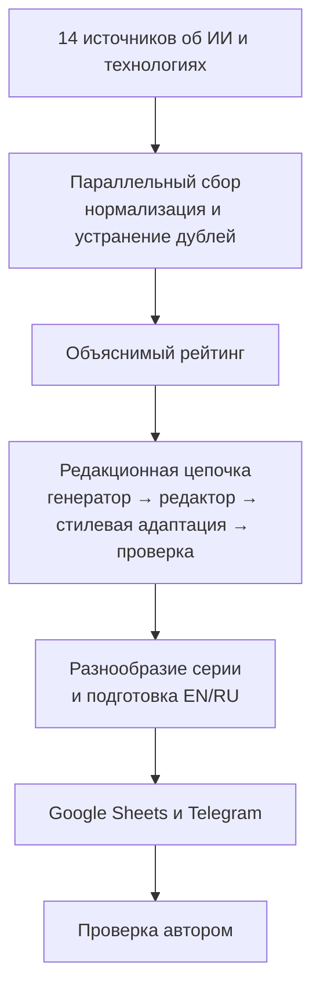
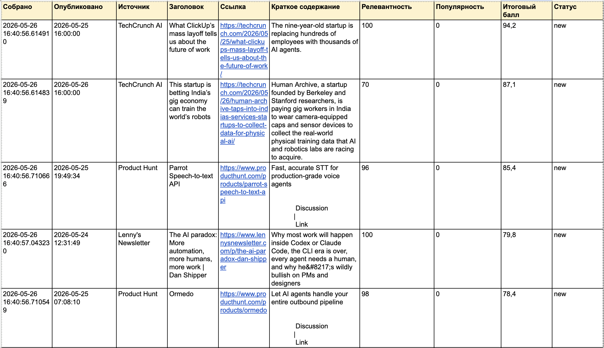
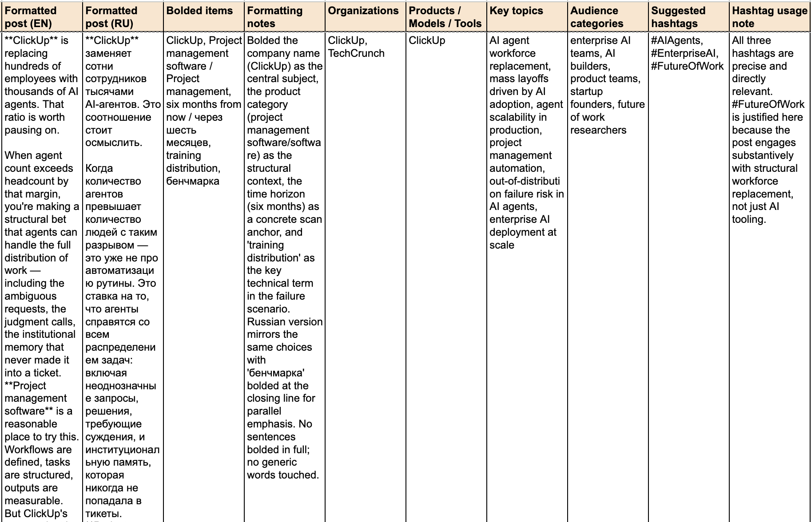

# Linked — персональный редакционный конвейер об ИИ и технологиях

Linked — двуязычный редакционный конвейер для LinkedIn. Он собирает материалы об ИИ и технологиях, отбирает наиболее значимые темы и готовит стилистически разнообразные черновики. Система объединяет объяснимую модель оценки, последовательную редакционную обработку, контроль повторов между публикациями, Google Sheets и ежедневную подборку в Telegram.



## Редакционная задача

Для качественной профессиональной ленты недостаточно одного запроса к модели. Нужно найти действительно важные темы в информационном шуме, объяснимо расставить приоритеты, не повторять уже использованные идеи и поддерживать разнообразие не только внутри одной публикации, но и во всей серии.

Linked автоматизирует этот редакционный процесс для профиля автора:

1. загружает использованные URL и последние публикации из Google Sheets;
2. параллельно собирает Hacker News и 13 RSS-источников;
3. фильтрует материалы по возрасту;
4. рассчитывает баллы релевантности, свежести и популярности;
5. нормализует URL и заголовки и объединяет дубли;
6. повторно упорядочивает пул кандидатов с учётом сходства, чтобы не тратить генерацию на несколько версий одного инфоповода;
7. рассматривает до десяти лучших кандидатов, готовит до пяти черновиков и проводит их через цепочку редакционных проверок;
8. сохраняет русские и английские черновики, метаданные и результаты проверок в Google Sheets;
9. отправляет ежедневную подборку в Telegram для проверки.

Окончательное редакционное решение и публикация остаются за автором. Это принципиальная часть процесса: автоматизация готовит объяснимый и проверяемый результат, но не публикует текст от имени человека без его участия.

## Объяснимый отбор

Расчёт рейтинга отделён от управления конвейером и задаётся конфигурацией:

```text
итог = (релевантность × 0.60 + свежесть × 0.25 + популярность × 0.15)
       × вес_источника
```

<p align="center">
  <a href="docs/assets/news-scoring.png">
    
  </a>
</p>
<p align="center"><sub>Собранные новости с релевантностью, популярностью и итоговым баллом: решение об отборе можно проверить до генерации текста.</sub></p>

Система учитывает:

- соответствие ключевым темам: ИИ, инструменты разработчика, создание продуктов, XR, мультимодальность, память и мышление, контроль качества, надёжность и инфраструктура ИИ;
- дополнительный вес для тематических сочетаний вроде ИИ + XR или ИИ + память;
- свежесть материала;
- популярность на Hacker News;
- коэффициент доверия и индивидуальный порог для каждого источника;
- стоп-слова и штрафы за шум.

Веса и пороги можно менять и тестировать без переписывания механики конвейера. Публичное ядро поддерживает тематические группы с ограничением вклада, бонусы за значимые сочетания, стоп-слова и штрафы за шум. `ScoreBreakdown` сохраняет не только четыре исходных компонента, но и сработавшие группы, бонусы и ограничения, поэтому решение об отборе можно объяснить без обращения к внутреннему состоянию системы. Рабочие словари и пороги источников не публикуются.

## Главная задача: качество всей серии

После генерации текст проходит несколько независимых редакционных этапов:

### Редактор

Уточняет аргумент, структуру и связь с исходным сигналом, сохраняя авторскую позицию.

### Стилевая адаптация

Убирает шаблонные признаки сгенерированного текста и приводит черновик к заданному авторскому тону.

### Автоматическая проверка на штампы ИИ

Проверяет запрещённые риторические конструкции, провокации ради вовлечения, стилистические повторы и структурный контракт.

### Сходство с предыдущими публикациями

Сравнивает черновик с последними публикациями по началу, концовке, способу постановки проблемы, развитию аргумента и центральной идее.

### Разнообразие выпуска

Контролирует разнообразие текущего выпуска, чтобы несколько качественных публикаций не складывались в однообразную ленту.

### Двуязычная подготовка

Готовит полные и короткие версии на русском и английском, форматированный текст, альтернативное начало, угол подачи, тип публикации, заметки о рисках, темы, организации, продукты, модели, сведения об аудитории и хештеги.

## Google Sheets как редакционное пространство

Google Sheets выполняет сразу несколько ролей:

- архив собранных новостей и рейтингов;
- рабочее пространство для черновиков, проверок, метаданных и редакционных статусов;
- реестр использованных URL;
- история последних публикаций для анализа сходства;
- журнал запусков с количеством материалов, черновиков, событий и ошибок выполнения.

<p align="center">
  <a href="docs/assets/editorial-audit.png">
    
  </a>
</p>
<p align="center"><sub>Редакционный журнал: угол подачи, напряжение, наблюдение, проверки редактора, сходство, источник и риски.</sub></p>

<p align="center">
  <a href="docs/assets/bilingual-metadata.png">
    
  </a>
</p>
<p align="center"><sub>Черновики на русском и английском, решения по форматированию, сущности, категории аудитории и проверенные хештеги.</sub></p>

Подборка в Telegram даёт автору ссылку на источник, отформатированную русскую версию, английский текст для копирования и короткую версию.

<p align="center">
  <a href="docs/assets/telegram-draft.png">
    
  </a>
</p>
<p align="center"><sub>Проверка человеком: контекст новости, русский черновик и готовые для копирования тексты на русском и английском с хештегами.</sub></p>

## Роль и объём работы

Работа над Linked охватывала весь редакционный процесс: модель рейтинга, правила авторского стиля, последовательность этапов, контроль качества и интеграции с Google Sheets и Telegram.

Ключевые решения:

- параллельный сбор из 14 источников;
- объяснимый рейтинг, задаваемый конфигурацией;
- ранняя нормализация и устранение дублей до этапов LLM;
- компактный набор фактов и контекста для генерации черновика;
- отдельные этапы редактуры и стилевой адаптации;
- автоматическая проверка на штампы ИИ;
- контроль сходства и разнообразия выпуска;
- двуязычная подготовка;
- проверка человеком через Sheets и Telegram;
- изоляция сбоев отдельных источников, сохранения и доставки результата.

## Что показывает этот репозиторий

В репозитории можно запустить основную часть отбора материалов и редакционного процесса:

1. параллельный сбор через единый контракт источника;
2. нормализацию URL и заголовков;
3. детерминированный отпечаток содержимого и устранение дублей;
4. формулу `relevance × 0.60 + freshness × 0.25 + popularity × 0.15` с весом источника и структурированным `ScoreBreakdown`;
5. отбор лучших материалов;
6. детерминированный отбор разнообразной серии с журналом базового рейтинга, сходства и скорректированного балла;
7. генерацию черновика через интерфейс `DraftProvider`;
8. исполняемую цепочку `clarity_editor → anti_slop_gate → similarity_gate`;
9. необязательную повторную редакцию через `DraftRevisionProvider` с полным повтором проверок;
10. журнал редакционных решений и отклонение шаблонных или слишком похожих текстов;
11. отчёт о запуске с результатами и изолированными ошибками сборщиков.

Код демонстрирует:

- контракты `Protocol` для заменяемых источников и генераторов;
- `asyncio.gather(..., return_exceptions=True)` для изоляции сборщиков;
- неизменяемые предметные модели на `dataclass(frozen=True, slots=True)`;
- последовательную цепочку редакционных этапов, где новая проверка добавляется без изменения управления процессом;
- ограниченный цикл «отклонение → редакция → повторная проверка» через заменяемый интерфейс;
- безопасный `dry-run` без записи данных;
- воспроизводимую локальную реализацию;
- тесты формулы, порядка редакционных этапов, устранения дублей и частичной деградации.

## Почему выбраны такие решения

### Сбой одного источника не останавливает выпуск

Каждый источник работает через общий контракт, а его результат фиксируется отдельно. Если один сборщик недоступен, остальные продолжают работу, а отчёт о запуске сохраняет полную картину выполнения.

### Дубли устраняются до генерации

URL и заголовки нормализуются до обращения к LLM. Каждый инфоповод попадает в отбор один раз, поэтому генерация не расходуется на дубли.

### Рейтинг отделён от механики

Редакционная стратегия выражена конфигурацией, поэтому веса, темы и пороги можно развивать независимо от реализации конвейера.

### Редакционные проверки собраны в цепочку этапов

Каждый этап реализует общий `EditorialStage`: он может изменить черновик, принять его или остановить обработку с объяснимой причиной. `ContentPipeline` сохраняет журнал решений и продолжает обрабатывать остальные материалы, если конкретный черновик отклонён.

### Внешние системы изолированы интерфейсами

Сборщики и генерация черновиков зависят от общих контрактов, а не от конкретного SDK. Локальная реализация позволяет воспроизвести весь основной процесс без внешних учётных данных.

## С чего начать обзор кода

1. [pipeline.py](src/linked_ai_content_pipeline/pipeline.py) — управление отбором, генерацией и редакционными решениями.
2. [scoring.py](src/linked_ai_content_pipeline/scoring.py) — объяснимая формула, тематические группы и `ScoreBreakdown`.
3. [selection.py](src/linked_ai_content_pipeline/selection.py) — отбор разнообразной серии и журнал скорректированного рейтинга.
4. [editorial.py](src/linked_ai_content_pipeline/editorial.py) — цепочка этапов, повторная редакция, проверка на штампы и сходство.
5. [normalization.py](src/linked_ai_content_pipeline/normalization.py) — нормализация и устранение дублей.
6. [collection.py](src/linked_ai_content_pipeline/collection.py) — параллельный сбор и изоляция сбоев.
7. [collectors.py](src/linked_ai_content_pipeline/collectors.py) и [providers.py](src/linked_ai_content_pipeline/providers.py) — интерфейсы внешних систем.
8. [test_selection.py](tests/test_selection.py) и [test_editorial.py](tests/test_editorial.py) — ключевые решения отбора и редактуры.

## Минимальный исполняемый сценарий

Требуется Python 3.11+.

```bash
python -m venv .venv
source .venv/bin/activate
pip install -e ".[dev]"
linked-pipeline
```

Команда выполняет безопасный `dry-run` и печатает рейтинг, решение об отборе серии, редакционный журнал и изолированную ошибку одного сборщика. Она подтверждает связность ядра, но не воспроизводит закрытые промпты, авторские словари или рабочие интеграции.

## Тесты и проверки

```bash
ruff format --check .
ruff check .
mypy src tests
bandit -q -r src
pytest
```

`pytest` требует не менее 90% покрытия исполняемого ядра. Те же проверки выполняются в GitHub Actions на Python 3.11 и 3.13.

## Границы публичного репозитория

Репозиторий показывает независимое ядро сбора, оценки и редакционного управления. Полная рабочая система расширяет базовую цепочку LLM-редактором, стилевой и двуязычной адаптацией, Google Sheets, подборкой в Telegram, расписанием и правилами авторского стиля.

## Автор

**Натали Антро — AI Product Engineer.**

Linked создан и запущен полностью самостоятельно — от концепции редакционного продукта и модели рейтинга до многоэтапной обработки текстов, интеграций, контроля качества, тестирования и автоматизации рабочего процесса.
