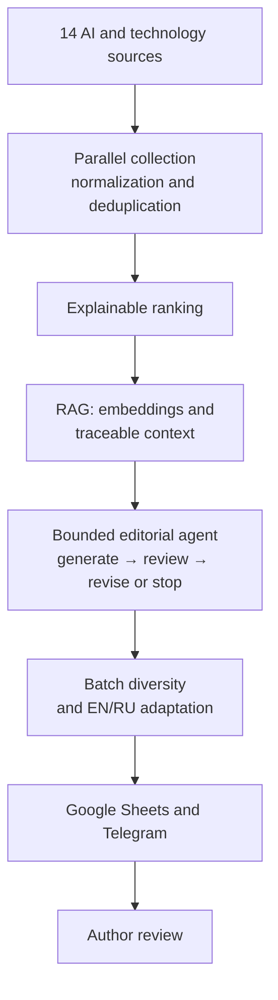

[🇬🇧 English](README.md) | [🇷🇺 Русский](README.ru.md)

# Linked — Personal Editorial Pipeline for AI and Technology

Linked is a bilingual editorial pipeline for LinkedIn. The production system collects AI and technology stories, selects the most significant topics, and prepares drafts with varied styles. It combines explainable scoring, a sequence of editorial stages, checks for repetition across posts, Google Sheets, and a daily Telegram digest.

> **Public engineering showcase.** This repository contains a standalone, reproducible implementation of explainable selection, RAG, the editorial agent, and evaluation from a commercial product. The full production system also includes private source configurations, rules for the author's voice, bilingual adaptation, Google Sheets and Telegram integrations, scheduling, and operational integrations.



## Editorial challenge

A professional feed needs more than a single model query. It requires finding important stories amid the noise, making priorities explainable, avoiding ideas already covered, and keeping both individual posts and the full batch varied.

Linked automates this editorial workflow for the author's profile:

1. Load previously used URLs and recent posts from Google Sheets.
2. Collect items from Hacker News and 13 RSS sources concurrently.
3. Filter items by age.
4. Score items for relevance, freshness, and popularity.
5. Normalize URLs and titles and merge duplicates.
6. Rerank the candidate pool by similarity so generation is spent on distinct stories.
7. Consider up to ten leading candidates, prepare up to five drafts, and run them through editorial checks.
8. Save English and Russian drafts, metadata, and check results in Google Sheets.
9. Send a daily digest to Telegram for review.

The author makes the final editorial decision and publishes the posts. The workflow provides explainable, reviewable drafts for that decision.

## RAG and a bounded editorial agent

Before generation, `TextChunker` normalizes and splits long documents with controlled overlap, then the pipeline retrieves semantically relevant context. Each passage retains its source URL. `EmbeddingProvider` and `VectorStore` separate the embedding strategy from storage. The code includes a deterministic local implementation and the full external path: `OpenAI-compatible embeddings → Qdrant → retrieval → LLM`.

`OpenAIContextDraftProvider` uses the Responses API with a strict JSON Schema and validates the output again at the trust boundary. Source material and retrieved context are serialized as `UNTRUSTED_INPUT_JSON`. Instructions in the data are treated as data, email addresses and phone numbers are redacted, and field sizes and passage counts are capped before the request. Generation receives the allowed `source_url` values. Revision receives the stage and rejection reason. External HTTP adapters share a timeout and bounded backoff policy for connection errors, `429` responses, and transient `5xx` responses.

Retrieval quality is measured separately from draft quality. `linked-rag-eval` runs ten ambiguous queries and queries with multiple relevant results, with explicit hard negatives. It reports per-case rankings, `Recall@k`, `Precision@k`, `HitRate@k`, `MRR`, `NDCG@k`, and the hard-negative rate. CI enforces minimum thresholds. The evaluation can run with a local word and character n-gram baseline or with external embeddings and Qdrant.

`linked-llm-eval` evaluates completed drafts across six scenarios. It checks lexical groundedness against allowed evidence, citation precision and recall, required concepts, unsupported numerical claims, and prohibited clichés. Each case runs three times, with results aggregated into stability rate and p95 latency. The deterministic local provider verifies that the evaluation contract is reproducible. The same suite runs against an external model with `LINKED_LLM_EVAL_PROVIDER=external`.

`BoundedEditorialAgent` runs a finite `retrieve_context → generate_draft → review → revise/stop` loop with separate limits on steps, retrieval depth, and revisions. Each action produces an `AgentTraceEntry`. A rejection or exception from the provider, agent, or review is recorded for that item as an `EditorialRejection` or `DraftFailure`. The rest of the batch continues.

## Explainable selection

Configuration controls scoring independently of pipeline orchestration:

```text
total = (relevance × 0.60 + freshness × 0.25 + popularity × 0.15)
        × source_weight
```

<p align="center">
  <a href="docs/assets/news-scoring.png">
    
  </a>
</p>
<p align="center"><sub>Review relevance, popularity, and total scores before generating drafts.</sub></p>

The system considers:

- Relevance to key topics: AI, developer tools, product development, XR, multimodality, memory and reasoning, quality assurance, reliability, and AI infrastructure.
- Bonuses for topical combinations such as AI + XR and AI + memory.
- Recency.
- Popularity on Hacker News.
- A trust weight and a threshold for each source.
- Stopwords and penalties for noise.

Weights and thresholds can be adjusted and tested independently of pipeline mechanics. The public core supports capped contributions from topic groups, bonuses for significant combinations, stopwords, and noise penalties. `ScoreBreakdown` records the four base components, the topic groups that matched, the bonuses, and the caps, so a selection decision can be explained from its score record. Production dictionaries and source thresholds are private.

## Editorial quality across the batch

After generation, each draft passes through several independent editorial stages:

### Editing

Refines the argument, structure, and connection to the source story while preserving the author's point of view.

### Style adaptation

Removes formulaic features of generated text and adapts the draft to the author's voice.

### Automated checks for AI clichés

Checks for prohibited rhetorical patterns, engagement bait, stylistic repetition, and compliance with the structural contract.

### Similarity to previous posts

Compares the draft with recent posts across the opening, closing, problem framing, development of the argument, and central idea.

### Batch diversity

Checks that the current batch offers enough variety across individually strong posts.

### Bilingual preparation

Produces full and short versions in Russian and English, formatted text, an alternative opening, an editorial angle, a post type, risk notes, topics, organizations, products, models, audience information, and hashtags.

## Google Sheets as an editorial workspace

Google Sheets serves several purposes:

- Archives collected stories and their scores.
- Hosts drafts, checks, metadata, and editorial statuses.
- Tracks previously used URLs.
- Stores recent posts for similarity analysis.
- Logs runs with counts of items, drafts, events, and errors.

<p align="center">
  <a href="docs/assets/editorial-audit.png">
    
  </a>
</p>
<p align="center"><sub>Editorial log showing the angle, tension, observation, editorial checks, similarity, source, and risks.</sub></p>

<p align="center">
  <a href="docs/assets/bilingual-metadata.png">
    
  </a>
</p>
<p align="center"><sub>Russian and English drafts, formatting decisions, entities, audience categories, and validated hashtags.</sub></p>

The Telegram digest gives the author the source link, a formatted Russian version, copy-ready English text, and a short version.

<p align="center">
  <a href="docs/assets/telegram-draft.png">
    
  </a>
</p>
<p align="center"><sub>Human review includes the story context, a Russian draft, and copy-ready Russian and English text with hashtags.</sub></p>

## Role and scope

My work covered the full editorial process: the scoring model, author voice guidelines, stage sequencing, quality checks, and Google Sheets and Telegram integrations.

Key decisions:

- Collect stories from 14 sources concurrently.
- Use explainable, configurable ranking.
- Normalize and deduplicate items before calling the LLM.
- Provide a compact set of facts and context for drafting.
- Separate editing from style adaptation.
- Check for AI clichés automatically.
- Control similarity and diversity across the batch.
- Prepare both language versions.
- Route drafts for human review through Sheets and Telegram.
- Isolate failures in individual sources, persistence, and delivery.

## What this repository demonstrates

The repository provides a standalone, reproducible implementation of material selection and editorial processing:

1. Concurrent collection through a shared source contract.
2. URL and title normalization.
3. Deterministic content fingerprinting and deduplication.
4. The formula `relevance × 0.60 + freshness × 0.25 + popularity × 0.15`, with a source weight and a structured `ScoreBreakdown`.
5. Selection of top-ranked items.
6. Deterministic selection of a diverse batch with a log of base scores, similarity, and adjusted scores.
7. Indexing and semantic retrieval through `EmbeddingProvider` and `VectorStore`.
8. A Qdrant adapter with idempotent upserts and source links.
9. A bounded editorial agent with a complete action trace.
10. A live Responses API adapter with strict structured output.
11. Retrieval evaluation across six ranking metrics and LLM draft evaluation against groundedness and citation invariants.
12. A runnable sequence of `clarity_editor → anti_slop_gate → similarity_gate`.
13. An editorial decision log and a typed report of isolated collector, provider, agent, and review failures.

The code demonstrates:

- `Protocol` contracts for interchangeable sources and draft generators.
- `asyncio.gather(..., return_exceptions=True)` to isolate collector failures.
- Immutable domain models built with `dataclass(frozen=True, slots=True)`.
- A sequence of editorial stages that can accept new checks without changing orchestration.
- A controlled reject, revise, and recheck loop through a replaceable interface.
- A `dry-run` mode that performs no writes.
- A reproducible local implementation.
- Tests for scoring, editorial stage order, deduplication, and partial failure.

## Design decisions

### Isolate failures from individual sources

Each source uses a common contract and reports its result separately. If one collector is unavailable, the others continue, and the run report records the full outcome.

### Deduplicate before generation

The pipeline normalizes URLs and titles before calling the LLM. Each story enters selection once, avoiding duplicate generation.

### Keep scoring independent of orchestration

Configuration expresses the editorial strategy so that weights, topics, and thresholds can evolve independently of the pipeline implementation.

### Compose editorial checks as stages

Each stage implements the shared `EditorialStage` contract and can revise a draft, accept it, or stop processing with a reason. `ContentPipeline` logs decisions and continues processing other items when a draft is rejected or the provider, agent, or review raises an exception. It records errors as `DraftFailure` with the item ID, stage, and error type. `CancelledError` propagates as cancellation.

### Isolate external systems behind interfaces

Collectors and draft generators use shared contracts that are independent of any particular SDK. The local implementation reproduces the full core workflow without external credentials.

## Where to start reading the code

1. [pipeline.py](src/linked_ai_content_pipeline/pipeline.py) — selection, generation, and editorial orchestration.
2. [agent.py](src/linked_ai_content_pipeline/agent.py) — bounded RAG agent loop and action trace.
3. [llm.py](src/linked_ai_content_pipeline/llm.py) — Responses API, strict output contract, and contextual editing.
4. [rag.py](src/linked_ai_content_pipeline/rag.py) — embeddings, vector store interface, local retrieval, and Qdrant REST API.
5. [retrieval_evaluation.py](src/linked_ai_content_pipeline/retrieval_evaluation.py) and [draft_evaluation.py](src/linked_ai_content_pipeline/draft_evaluation.py) — RAG ranking metrics and quality gates for LLM drafts.
6. [scoring.py](src/linked_ai_content_pipeline/scoring.py) — explainable scoring formula, topic groups, and `ScoreBreakdown`.
7. [selection.py](src/linked_ai_content_pipeline/selection.py) — batch diversity and adjusted score logging.
8. [editorial.py](src/linked_ai_content_pipeline/editorial.py) — editorial stages, revision, cliché checks, and similarity checks.
9. [normalization.py](src/linked_ai_content_pipeline/normalization.py) — normalization and deduplication.
10. [collection.py](src/linked_ai_content_pipeline/collection.py) — concurrent collection and failure isolation.
11. [collectors.py](src/linked_ai_content_pipeline/collectors.py) and [providers.py](src/linked_ai_content_pipeline/providers.py) — external system interfaces.
12. [test_llm.py](tests/test_llm.py), [test_retrieval_evaluation.py](tests/test_retrieval_evaluation.py), and [test_draft_evaluation.py](tests/test_draft_evaluation.py) — prompt and data boundary, RAG metrics, and adversarial draft checks.

## Minimal runnable example

Requires Python 3.11+.

```bash
python -m venv .venv
source .venv/bin/activate
pip install -r requirements-dev.lock
pip install --no-build-isolation --no-deps .
linked-pipeline
```

The command performs a reproducible `dry-run` and prints rankings, batch selection decisions, the editorial log, and the result of isolating an individual collector failure.

To exercise the full external RAG and LLM workflow, set the values from `.env.example`, start Qdrant, and explicitly select both external providers:

```bash
docker compose up -d qdrant
LINKED_RETRIEVAL_PROVIDER=external LINKED_LLM_PROVIDER=external linked-pipeline
```

Use the same provider setting to evaluate external embeddings and Qdrant:

```bash
LINKED_RETRIEVAL_PROVIDER=external linked-rag-eval
LINKED_LLM_EVAL_PROVIDER=external LLM_EVAL_RUNS=3 linked-llm-eval
```

Local mode is the default and requires neither network access nor credentials. CI checks the live Qdrant adapter with a dedicated service container.

## Tests and checks

```bash
ruff format --check .
ruff check .
mypy src tests
bandit -q -r src
pip-audit -r requirements-runtime.lock
pytest
linked-rag-eval
linked-llm-eval
```

`pytest` requires at least 90% coverage of the runnable core. GitHub Actions runs the same checks, including an audit for known runtime dependency vulnerabilities, on Python 3.11 and 3.13. The Qdrant service image is pinned by immutable digest.

## Scope of the public implementation

The public implementation covers collection, explainable ranking, RAG, bounded editing, quality checks, and decision logging. The production system uses the same contracts for voice and bilingual adaptation, Google Sheets, the Telegram digest, scheduling, and author voice guidelines.

## Author

**Natali Antro — AI Product Engineer, creator, and sole developer of the product.**
