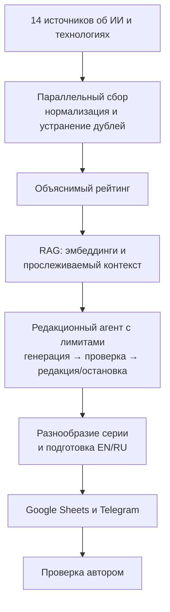
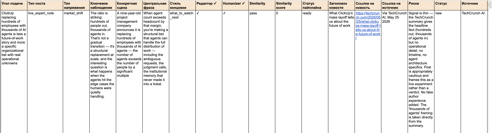
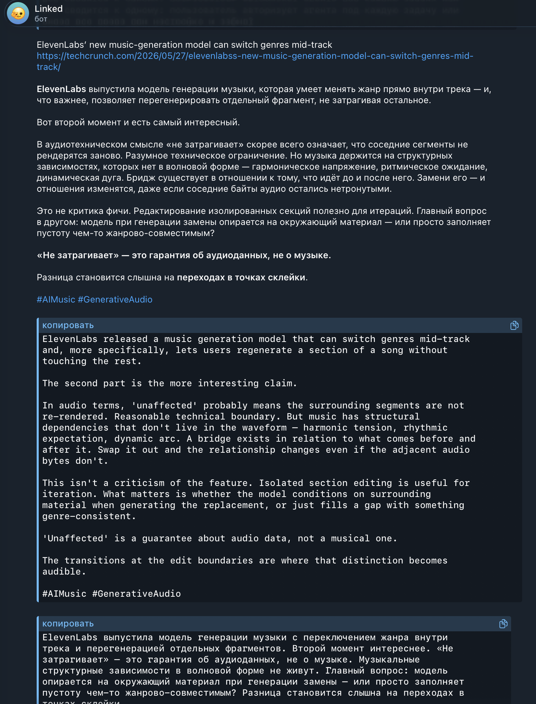

# Linked — персональный редакционный конвейер об ИИ и технологиях

Linked — двуязычный редакционный конвейер для LinkedIn. Рабочая система собирает материалы об ИИ и технологиях, отбирает наиболее значимые темы и готовит стилистически разнообразные черновики. Она объединяет объяснимую модель оценки, последовательную редакционную обработку, контроль повторов между публикациями, Google Sheets и ежедневную подборку в Telegram.

> **Публичный engineering showcase.** Репозиторий выделяет самостоятельный воспроизводимый контур реального коммерческого продукта: объяснимый отбор, RAG, редакционный агент и evaluation. Полная production-система шире и дополнительно включает рабочие конфигурации источников, правила авторского стиля, двуязычную адаптацию, Google Sheets, Telegram, расписание и эксплуатационные интеграции, которые не публикуются.



## Редакционная задача

Для качественной профессиональной ленты недостаточно одного запроса к модели. Нужно найти действительно важные темы в информационном шуме, объяснимо расставить приоритеты, не повторять уже использованные идеи и поддерживать разнообразие не только внутри одной публикации, но и во всей серии.

Linked автоматизирует этот редакционный процесс для профиля автора:

1. загружает использованные URL и последние публикации из Google Sheets;
2. параллельно собирает Hacker News и 13 RSS-источников;
3. фильтрует материалы по возрасту;
4. рассчитывает баллы релевантности, свежести и популярности;
5. нормализует URL и заголовки и объединяет дубли;
6. повторно упорядочивает пул кандидатов с учётом сходства, чтобы не тратить генерацию на несколько версий одного инфоповода;
7. рассматривает до десяти лучших кандидатов, готовит до пяти черновиков и проводит их через цепочку редакционных проверок;
8. сохраняет русские и английские черновики, метаданные и результаты проверок в Google Sheets;
9. отправляет ежедневную подборку в Telegram для проверки.

Окончательное редакционное решение и публикация остаются за автором. Это принципиальная часть процесса: автоматизация готовит объяснимый и проверяемый результат, но не публикует текст от имени человека без его участия.

## RAG и управляемый редакционный агент

Перед генерацией `TextChunker` нормализует и разбивает длинные документы с контролируемым перекрытием, затем конвейер извлекает семантически близкий контекст. Каждый фрагмент сохраняет ссылку на источник. `EmbeddingProvider` и `VectorStore` отделяют стратегию эмбеддингов от хранилища. В коде есть детерминированная локальная реализация и полный внешний путь `OpenAI-compatible embeddings → Qdrant → retrieval → LLM`.

`OpenAIContextDraftProvider` подключает Responses API через строгую JSON Schema и повторно проверяет результат на доверительной границе. Исходный материал и retrieved context сериализуются как `UNTRUSTED_INPUT_JSON`: инструкции внутри данных не исполняются, email и телефоны редактируются, а размер каждого поля и число фрагментов ограничены до запроса. Генерация получает разрешённые `source_url`, а повторная редактура — этап и причину отклонения. Внешние HTTP-адаптеры используют общую политику тайм-аутов и ограниченного backoff для ошибок соединения, `429` и временных `5xx`.

Качество поиска измеряется отдельно от качества текста. `linked-rag-eval` выполняет десять неоднозначных и multi-relevant запросов с явными hard negatives; отчёт содержит per-case ranking, `Recall@k`, `Precision@k`, `HitRate@k`, `MRR`, `NDCG@k` и hard-negative rate, а CI применяет минимальные пороги. Оценку можно выполнить как с локальным word/character-ngram baseline, так и через внешний контур embeddings и Qdrant.

`linked-llm-eval` отдельно оценивает готовые черновики по шести сценариям: lexical groundedness относительно разрешённых evidence, citation precision/recall, обязательные понятия, неизвестные числовые утверждения и запрещённые клише. Каждый case выполняется три раза и агрегируется в stability rate и p95 latency. Локальный deterministic provider проверяет воспроизводимость evaluation contract; тот же набор запускается через реальную модель с `LINKED_LLM_EVAL_PROVIDER=external`.

`BoundedEditorialAgent` выполняет конечный цикл `retrieve_context → generate_draft → review → revise/stop`. У него есть отдельные лимиты на число шагов, глубину поиска и повторную редактуру. Каждое действие попадает в `AgentTraceEntry`. Отклонение и исключение provider/agent/review фиксируются для конкретного материала в `EditorialRejection` или `DraftFailure` и не отменяют обработку остальных материалов выпуска.

## Объяснимый отбор

Расчёт рейтинга отделён от управления конвейером и задаётся конфигурацией:

```text
итог = (релевантность × 0.60 + свежесть × 0.25 + популярность × 0.15)
       × вес_источника
```

<p align="center">
  <a href="docs/assets/news-scoring.png">
    
  </a>
</p>
<p align="center"><sub>Собранные новости с релевантностью, популярностью и итоговым баллом: решение об отборе можно проверить до генерации текста.</sub></p>

Система учитывает:

- соответствие ключевым темам: ИИ, инструменты разработчика, создание продуктов, XR, мультимодальность, память и мышление, контроль качества, надёжность и инфраструктура ИИ;
- дополнительный вес для тематических сочетаний вроде ИИ + XR или ИИ + память;
- свежесть материала;
- популярность на Hacker News;
- коэффициент доверия и индивидуальный порог для каждого источника;
- стоп-слова и штрафы за шум.

Веса и пороги можно менять и тестировать без переписывания механики конвейера. Публичное ядро поддерживает тематические группы с ограничением вклада, бонусы за значимые сочетания, стоп-слова и штрафы за шум. `ScoreBreakdown` сохраняет не только четыре исходных компонента, но и сработавшие группы, бонусы и ограничения, поэтому решение об отборе можно объяснить без обращения к внутреннему состоянию системы. Рабочие словари и пороги источников не публикуются.

## Главная задача: качество всей серии

После генерации текст проходит несколько независимых редакционных этапов:

### Редактор

Уточняет аргумент, структуру и связь с исходным сигналом, сохраняя авторскую позицию.

### Стилевая адаптация

Убирает шаблонные признаки сгенерированного текста и приводит черновик к заданному авторскому тону.

### Автоматическая проверка на штампы ИИ

Проверяет запрещённые риторические конструкции, провокации ради вовлечения, стилистические повторы и структурный контракт.

### Сходство с предыдущими публикациями

Сравнивает черновик с последними публикациями по началу, концовке, способу постановки проблемы, развитию аргумента и центральной идее.

### Разнообразие выпуска

Контролирует разнообразие текущего выпуска, чтобы несколько качественных публикаций не складывались в однообразную ленту.

### Двуязычная подготовка

Готовит полные и короткие версии на русском и английском, форматированный текст, альтернативное начало, угол подачи, тип публикации, заметки о рисках, темы, организации, продукты, модели, сведения об аудитории и хештеги.

## Google Sheets как редакционное пространство

Google Sheets выполняет сразу несколько ролей:

- архив собранных новостей и рейтингов;
- рабочее пространство для черновиков, проверок, метаданных и редакционных статусов;
- реестр использованных URL;
- история последних публикаций для анализа сходства;
- журнал запусков с количеством материалов, черновиков, событий и ошибок выполнения.

<p align="center">
  <a href="docs/assets/editorial-audit.png">
    
  </a>
</p>
<p align="center"><sub>Редакционный журнал: угол подачи, напряжение, наблюдение, проверки редактора, сходство, источник и риски.</sub></p>

<p align="center">
  <a href="docs/assets/bilingual-metadata.png">
    
  </a>
</p>
<p align="center"><sub>Черновики на русском и английском, решения по форматированию, сущности, категории аудитории и проверенные хештеги.</sub></p>

Подборка в Telegram даёт автору ссылку на источник, отформатированную русскую версию, английский текст для копирования и короткую версию.

<p align="center">
  <a href="docs/assets/telegram-draft.png">
    
  </a>
</p>
<p align="center"><sub>Проверка человеком: контекст новости, русский черновик и готовые для копирования тексты на русском и английском с хештегами.</sub></p>

## Роль и объём работы

Работа над Linked охватывала весь редакционный процесс: модель рейтинга, правила авторского стиля, последовательность этапов, контроль качества и интеграции с Google Sheets и Telegram.

Ключевые решения:

- параллельный сбор из 14 источников;
- объяснимый рейтинг, задаваемый конфигурацией;
- ранняя нормализация и устранение дублей до этапов LLM;
- компактный набор фактов и контекста для генерации черновика;
- отдельные этапы редактуры и стилевой адаптации;
- автоматическая проверка на штампы ИИ;
- контроль сходства и разнообразия выпуска;
- двуязычная подготовка;
- проверка человеком через Sheets и Telegram;
- изоляция сбоев отдельных источников, сохранения и доставки результата.

## Что показывает этот репозиторий

Репозиторий содержит самостоятельный воспроизводимый контур отбора материалов и редакционного процесса:

1. параллельный сбор через единый контракт источника;
2. нормализацию URL и заголовков;
3. детерминированный отпечаток содержимого и устранение дублей;
4. формулу `relevance × 0.60 + freshness × 0.25 + popularity × 0.15` с весом источника и структурированным `ScoreBreakdown`;
5. отбор лучших материалов;
6. детерминированный отбор разнообразной серии с журналом базового рейтинга, сходства и скорректированного балла;
7. индексацию и семантический поиск через `EmbeddingProvider` и `VectorStore`;
8. Qdrant-адаптер с идемпотентным upsert и ссылками на источники;
9. редакционный агент с лимитами шагов и полной трассой действий;
10. реальный адаптер Responses API со строгим структурированным результатом;
11. evaluation retrieval по шести ranking-метрикам и LLM-черновиков по groundedness/citation-инвариантам;
12. исполняемую цепочку `clarity_editor → anti_slop_gate → similarity_gate`;
13. журнал редакционных решений и typed-отчёт об изолированных ошибках collector/provider/agent/review.

Код демонстрирует:

- контракты `Protocol` для заменяемых источников и генераторов;
- `asyncio.gather(..., return_exceptions=True)` для изоляции сборщиков;
- неизменяемые предметные модели на `dataclass(frozen=True, slots=True)`;
- последовательную цепочку редакционных этапов, где новая проверка добавляется без изменения управления процессом;
- управляемый цикл «отклонение → редакция → повторная проверка» через заменяемый интерфейс;
- безопасный `dry-run` без записи данных;
- воспроизводимую локальную реализацию;
- тесты формулы, порядка редакционных этапов, устранения дублей и частичной деградации.

## Почему выбраны такие решения

### Сбой одного источника не останавливает выпуск

Каждый источник работает через общий контракт, а его результат фиксируется отдельно. Если один сборщик недоступен, остальные продолжают работу, а отчёт о запуске сохраняет полную картину выполнения.

### Дубли устраняются до генерации

URL и заголовки нормализуются до обращения к LLM. Каждый инфоповод попадает в отбор один раз, поэтому генерация не расходуется на дубли.

### Рейтинг отделён от механики

Редакционная стратегия выражена конфигурацией, поэтому веса, темы и пороги можно развивать независимо от реализации конвейера.

### Редакционные проверки собраны в цепочку этапов

Каждый этап реализует общий `EditorialStage`: он может изменить черновик, принять его или остановить обработку с объяснимой причиной. `ContentPipeline` сохраняет журнал решений и продолжает обрабатывать остальные материалы, если конкретный черновик отклонён или provider/agent/review завершился исключением. Ошибка становится `DraftFailure` с material ID, этапом и типом; `CancelledError` не маскируется как предметная ошибка.

### Внешние системы изолированы интерфейсами

Сборщики и генерация черновиков зависят от общих контрактов, а не от конкретного SDK. Локальная реализация позволяет воспроизвести весь основной процесс без внешних учётных данных.

## С чего начать обзор кода

1. [pipeline.py](src/linked_ai_content_pipeline/pipeline.py) — управление отбором, генерацией и редакционными решениями.
2. [agent.py](src/linked_ai_content_pipeline/agent.py) — управляемый цикл RAG-агента и трасса действий.
3. [llm.py](src/linked_ai_content_pipeline/llm.py) — Responses API, строгий контракт результата и контекстная редактура.
4. [rag.py](src/linked_ai_content_pipeline/rag.py) — эмбеддинги, интерфейс векторного хранилища, локальный поиск и Qdrant REST API.
5. [retrieval_evaluation.py](src/linked_ai_content_pipeline/retrieval_evaluation.py) и [draft_evaluation.py](src/linked_ai_content_pipeline/draft_evaluation.py) — ranking-метрики RAG и quality gates LLM-черновика.
6. [scoring.py](src/linked_ai_content_pipeline/scoring.py) — объяснимая формула, тематические группы и `ScoreBreakdown`.
7. [selection.py](src/linked_ai_content_pipeline/selection.py) — отбор разнообразной серии и журнал скорректированного рейтинга.
8. [editorial.py](src/linked_ai_content_pipeline/editorial.py) — цепочка этапов, повторная редакция, проверка на штампы и сходство.
9. [normalization.py](src/linked_ai_content_pipeline/normalization.py) — нормализация и устранение дублей.
10. [collection.py](src/linked_ai_content_pipeline/collection.py) — параллельный сбор и изоляция сбоев.
11. [collectors.py](src/linked_ai_content_pipeline/collectors.py) и [providers.py](src/linked_ai_content_pipeline/providers.py) — интерфейсы внешних систем.
12. [test_llm.py](tests/test_llm.py), [test_retrieval_evaluation.py](tests/test_retrieval_evaluation.py) и [test_draft_evaluation.py](tests/test_draft_evaluation.py) — prompt/data boundary, метрики RAG и adversarial проверки черновика.

## Минимальный исполняемый сценарий

Требуется Python 3.11+.

```bash
python -m venv .venv
source .venv/bin/activate
pip install -r requirements-dev.lock
pip install --no-build-isolation --no-deps .
linked-pipeline
```

Команда выполняет воспроизводимый `dry-run` и выводит рейтинг, решение об отборе серии, редакционный журнал и результат изоляции сбоя отдельного сборщика.

Для проверки полного внешнего RAG- и LLM-контура необходимо задать параметры из `.env.example`, запустить Qdrant и явно выбрать оба внешних провайдера:

```bash
docker compose up -d qdrant
LINKED_RETRIEVAL_PROVIDER=external LINKED_LLM_PROVIDER=external linked-pipeline
```

Метрики для внешних эмбеддингов и Qdrant запускаются тем же переключателем:

```bash
LINKED_RETRIEVAL_PROVIDER=external linked-rag-eval
LINKED_LLM_EVAL_PROVIDER=external LLM_EVAL_RUNS=3 linked-llm-eval
```

Локальный режим остаётся режимом по умолчанию и не требует сети или учётных данных. Живая проверка Qdrant-адаптера выполняется в CI на отдельном сервисном контейнере.

## Тесты и проверки

```bash
ruff format --check .
ruff check .
mypy src tests
bandit -q -r src
pip-audit -r requirements-runtime.lock
pytest
linked-rag-eval
linked-llm-eval
```

`pytest` требует не менее 90% покрытия исполняемого ядра. Те же проверки, включая аудит известных уязвимостей runtime-зависимостей, выполняются в GitHub Actions на Python 3.11 и 3.13. Сервисный образ Qdrant закреплён immutable digest.

## Публичный инженерный контур

Публичный контур охватывает сбор, объяснимый рейтинг, RAG, управляемую редактуру, контроль качества и аудит решений. Рабочая система подключает те же контракты к стилевой и двуязычной адаптации, Google Sheets, подборке в Telegram, расписанию и правилам авторского стиля.

## Автор

**Натали Антро — AI Product Engineer, создатель и единственный разработчик продукта.**
