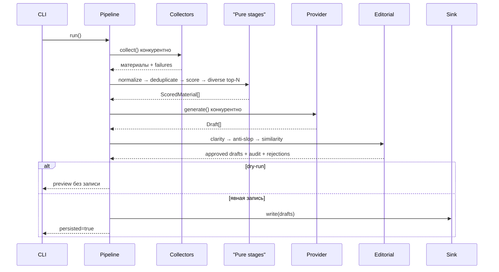

# Архитектура

## Цель

Конвейер выделяет тестируемую архитектуру обработки контентных сигналов из реального
редакционного продукта. Внешние интеграции представлены узкими интерфейсами, чтобы
управление процессом и правила отбора проверялись независимо от конкретных SDK.

## Компоненты

| Компонент | Ответственность | Side effects |
|---|---|---|
| `Collector` | Асинхронно получить `RawMaterial` | Зависит от adapter |
| `collect_concurrently` | Запустить источники и собрать ошибки | Нет |
| `normalization` | Канонизировать URL и текст, удалить дубликаты | Нет |
| `scoring` | Рассчитать рейтинг, объяснение компонентов, фильтр и первые N материалов | Нет |
| `selection` | Пересобрать верхнюю часть рейтинга с учётом сходства и записать решение | Нет |
| `DraftProvider` | Создать `Draft` из выбранного материала | Зависит от provider |
| `EditorialChain` | Применить редакционные проверки, при необходимости запросить исправление и записать журнал решений | Только через необязательный `DraftRevisionProvider` |
| `ContentPipeline` | Связать этапы и применить dry-run policy | Только через sink |
| `DraftSink` | Сохранить готовые черновики | Да, только явно |

## Поток выполнения

## Инварианты

- Один упавший collector не отменяет успешные collectors.
- Порядок выбранных материалов определяется score, затем временем публикации.
- Повтором считается совпадение canonical URL или content fingerprint.
- Score вычисляется из relevance, freshness и popularity, затем умножается на source weight.
- Вклад тематической группы ограничен; бонус сочетания применяется только при наличии всех требуемых групп.
- Отбор серии детерминирован: скорректированный балл равен базовому рейтингу за вычетом штрафа за максимальное сходство с уже выбранными материалами.
- Editorial stages выполняются в заданном порядке; отклонение одного draft не отменяет остальные.
- Исправленный черновик проходит всю цепочку заново, а число раундов ограничено конфигурацией.
- `dry_run=True` никогда не вызывает sink.
- Локальный сценарий не требует сетевых клиентов и обязательных переменных окружения.

## Расширение

Новый источник реализует `Collector`, новый генератор — `DraftProvider`, редакционная проверка —
`EditorialStage`, повторная редакция — `DraftRevisionProvider`, а новый способ сохранения —
`DraftSink`. Управление процессом при этом не меняется. Для внешних адаптеров отдельно
потребуются тайм-ауты, ограниченные повторы, управление частотой запросов, очистка логов от
чувствительных данных и контрактные тесты.
